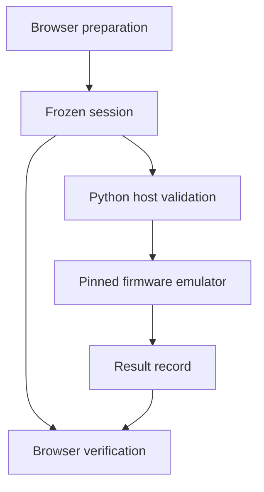

# Architecture

The Console supports public fixture development. The browser and local Python
bridge run on the same assumed-trusted development host. Neither is a substitute
for an offline device's trusted display or authorization parser.

## Components

| File | Responsibility |
| --- | --- |
| dist/protocol.mjs | Exact amount conversion, base58, canonical messages, envelope and result validation |
| dist/crypto.mjs | Hashing and strict Ed25519 verification; optional WebCrypto cross-check |
| dist/app.mjs | Prepare/review/verify state, file import/export, review-page coverage |
| dist/squads.mjs | Narrow unsigned Squads encoder, bounded byte decoder, PDA derivation and draft validation |
| dist/squads-ui.mjs | Separate Squads draft state, review acknowledgement, file exchange and manual stale-state comparison |
| tools/sign_fixture.py | Independent Python host parser, baseline or opt-in parser ROM execution, OpenSSL comparison |
| firmware/sol_policy.s | Original 65C02 parser over the frozen message; fixed public-fixture policy only |
| tools/firmware_policy.py | Check baseline ROM, insert a pre-sign gate and measure the experimental build |
| tools/upstream.py | Verify source closure/import origin and isolate native emulator builds |
| tools/fetch_upstream.py | Fetch twelve files at one upstream revision and verify their hashes |
| tools/verify.py | Run tests and reproduce baseline plus parser-enabled outputs without replacing them |
| upstream-lock.json | Commit and per-file source hashes |

## Boundaries

| Boundary | Checked here | Remaining assumption |
| --- | --- | --- |
| Form to session | Canonical layout and exact integer amount | Browser and delivered JavaScript are trustworthy |
| Squads draft to review | Instruction order, permissions, exact inner transfer, derived addresses and metadata binding | Supplied multisig, membership, threshold, balances and nonce/index state are unverified |
| Imported session to bridge | Independent byte parser, metadata/hash/envelope equality, fixed test key | Python process, compiler, OpenSSL and host are trustworthy |
| Fetched source to execution | Every imported source file matches its pin; native library rebuilt in a temporary directory | Pins were reviewed; host tooling and Python import environment are trustworthy |
| Result to browser | Format, binding and strict signature verification | A valid public test-key signature does not prove device provenance |
| Emulator to physical device | No physical claim is made | Actual isolation, erasure, timing and fault behavior need hardware measurement |

## Session lifecycle

Preparation serializes the transaction once and decodes those bytes for review.
The user must visit every recipient page before acknowledging and exporting.
Changing preparation fields clears the prepared session and verification state.
Generation counters prevent older asynchronous preparation or verification
results from replacing newer UI state.

This is an interaction safeguard on the development host. A malicious host can
replace the entire interface. A future device must independently decode and
display the same bytes it signs.

The optional `--firmware-policy` build checks these frozen message bytes again
inside the emulated 65C02 before signing. This implements parsing only. It does
not display a trusted review or wait for device approval, and its entry guard
does not repair the upstream reset entry. See FIRMWARE_POLICY.md for the exact
ABI, ROM/RAM boundaries and missing authorization steps.

## Dependencies and network use

The static interface makes no chain or wallet calls. It reads bundled fixture
JSON and vendored crypto modules. Google Fonts is the only deliberate external
UI resource; block or self-host it for a fully offline development copy.

The source-fetch tool accesses raw.githubusercontent.com. npm is needed for the
test suites and to rebuild vendored modules, not to serve the prebuilt interface.
The existing lockfile pins versions and registry
integrities. There is no backend, account system, seed collection, or telemetry.

Result evidence fields describe the local bridge run but are not signed hardware
attestations. The browser verifies the record itself and does not trust evidence
booleans as proof of any security property.

## Separate Squads draft lifecycle

The unsigned Squads draft is a separate format and cannot enter the existing
fixture signing bridge. Its review is decoded from the outer message, including
the embedded vault transfer. Import recomputes the full review and message hash;
changed metadata, failed imports and preparation edits invalidate prior review.
An attempted state comparison that differs or cannot be validated blocks export
until the user prepares and reviews a new draft. Manual matches remain unverified.

The official Squads SDK and web3.js are test-only dependencies. Browser code uses
the restricted Console codec and existing vendored crypto modules. There is no
Squads signing, RPC retrieval or execution path. See SQUADS.md for the accepted
message language and the local-validator acceptance work still required.
